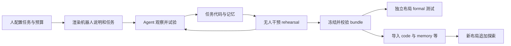

# RAX：作者如何适配新本体与新场景

更新：2026-11-05。研究目标：在 RTX 4070 Laptop 上用现成仿真 benchmark 验证 RAX 的适配机制。

**目前最有代码依据的答案：新本体靠人工实现、标定并说明控制与感知接口；新场景靠 agent 在这些接口上做在线试验，修改任务程序和记忆，再冻结程序测试。可复用的是工作流程、接口契约和部分技能，不是一个自动把任意机器人动作互相转换的模块。**

本报告区分三种证据：论文描述、当前公开代码、本机实测。全部实现分支已拉取并建立文件索引；适配主链已重点阅读，尚未完成所有代码逐行精读。详细边界见同目录《阅读覆盖.md》，不能把静态索引当作精读完成。

## 1. 先定位真正可运行的仓库

用户 fork 的 `main` 是文档入口，没有 benchmark 实现。已保留 `origin`，添加官方 `upstream`，获取 10 个实现分支。目前 `rax` 检出 `study/libero-pro-native`，对应官方 `libero-pro/native` 的 `1767412c5300b9358059ae6a39740c3c28d2b8b9`。上游源码未修改。

| 分支族 | 适配对象 | 对研究问题的作用 |
| --- | --- | --- |
| `libero-pro/*` | Franka Panda，MuJoCo 桌面操作 | 最适合先验证布局变化后的程序适配 |
| `dexjoco/*` | 灵巧操作仿真 | 观察不同动作维度、接触与工具接口 |
| `humanoid-arena/*` | 人形机器人仿真 | 观察全身运动接口及已有低层控制器依赖 |
| `robodojo-behavior/*` | 移动操作与家庭任务 | 观察导航、长任务、技能组合 |
| `real/franka`、`real/rainbow` | 真实单臂、移动双臂 | 展示新本体接入的实际工程量 |

`native/container` 主要改变部署与隔离方式，不代表不同的学习算法。分支之间有大量相同文件，但也存在实现差异，不能只看一个分支就认为覆盖全部。

论文为 [Scaling Online Exploration for Robot Agents](https://arxiv.org/html/2610.22496v1)，项目入口为 [RAX 项目页](https://robot-agent-exploration.com/)。正文和相关附录描述了冻结语言模型、在线探索、生成自主程序与记忆积累；这与下面的代码链路一致。论文中的成绩是作者报告，本机尚未重现实验。

## 2. 新本体：哪些工作由人完成

作者的 [真实机器人适配指南](https://github.com/robot-agent-exploration/rax/blob/db744f5950582c7c301f249192c0ed3c76517dd8/docs/REAL_ROBOT_ADAPTATION.md) 明确要求从最接近的参考分支开始：单臂参考 Franka，移动、多肢体参考 Rainbow。需要接入以下层次。

| 层次 | 适配内容 | 为什么影响 agent |
| --- | --- | --- |
| 驱动与 backend | SDK、连接、状态、动作、停止、错误返回 | agent 必须有可靠且可诊断的动作入口 |
| 几何与控制 | 关节限位、URDF/FK/IK、末端工具、工作空间、控制周期 | 相同的“移动 5 cm”在不同接口中含义不同 |
| 感知 | RGB-D、内外参、坐标系、时间戳、有效深度 | 程序需要把像素变成可执行的空间目标 |
| 工具契约 | 参数名、单位、绝对/相对、四元数次序、返回语义 | 避免语言模型靠猜测调用硬件 |
| 实测能力说明 | 精度、延迟、夹爪表现、控制器漂移及失败模式 | 让 agent 基于实际系统设计任务策略 |
| workspace 与 skills | 根据本体渲染机器人说明、控制/感知技能、任务文本 | 进入会话时拿到的是当前本体的接口知识 |
| 运行管理 | 操作员请求、日志、观测发布、权限、技能库 | 支持可追溯试验和后续复用 |

这不是仅换 URDF。以 Franka 为例，公开实现中同时有数值 IK、路径可行性检查以及测量反馈下的末端伺服。`PoseServo.move_tcp` 会根据测量误差调整命令；`ik.check_line` 会沿路径检查，而不只是求一个终点解。它们是人提供的通用控制能力，任务 agent 再在其上写抓取、擦拭、开抽屉等程序。[servo.py](https://github.com/robot-agent-exploration/rax/blob/8858d7f3e34eff382abae738cf0578d2726a9a0a/services/franka/servo.py#L59)、[ik.py](https://github.com/robot-agent-exploration/rax/blob/8858d7f3e34eff382abae738cf0578d2726a9a0a/services/franka/ik.py#L56)

**阅读时发现的文档差异：**主分支指南将 Rainbow 的 `rby1_move_eef` 示例描述为 IK 后关节空间运动；当前 Rainbow 实现默认 `controller_commands=True`，实际先进入控制器的 Cartesian 路径，关节路径是另一分支。移植时应以所用 commit 的执行路径为准。[默认配置](https://github.com/robot-agent-exploration/rax/blob/36c926ca3cf15921c6fc746a4bf309c26b0aa3c4/services/rby1/controller_modes.py#L48)、[实际分派](https://github.com/robot-agent-exploration/rax/blob/36c926ca3cf15921c6fc746a4bf309c26b0aa3c4/services/rby1/backend.py#L997)

类似地，指南提出的逐周期检查不能自动视为所有后端路径都已实现；Franka 的关节运动路径存在一次阻塞 bridge 调用，bridge 外部实现不在这份仓库里。新本体需要逐条验证动作链，不能仅凭接口名称推断执行保证。

## 3. LIBERO 是如何被接进 RAX 的

`services/benchmarks.py` 定义 benchmark 的元数据与 hooks；`services/libero_pro/benchmark.py` 将任务、规则、工具、演示图与 backend 接上通用 harness。`backend.py` 管理可信执行入口；`process.py` 启动独立模拟器进程；`session.py` 调用官方 `OffScreenRenderEnv`，处理 reset、观测、动作与成功判定。主环境 Python 3.12 与模拟器 Python 3.8 隔离，避免把仿真依赖直接混进 agent 运行环境。[registry](https://github.com/robot-agent-exploration/rax/blob/1767412c5300b9358059ae6a39740c3c28d2b8b9/services/benchmarks.py#L19)、[adapter](https://github.com/robot-agent-exploration/rax/blob/1767412c5300b9358059ae6a39740c3c28d2b8b9/services/libero_pro/benchmark.py)、[session](https://github.com/robot-agent-exploration/rax/blob/1767412c5300b9358059ae6a39740c3c28d2b8b9/services/libero_pro/session.py#L61)

这里具体暴露的本体知识包括：

- 7 维 OSC 相对动作：位置、旋转和夹爪；20 Hz。标称位置缩放是每单位 0.05 m，旋转每单位 0.5 rad，夹爪 -1 打开、+1 闭合。标称目标变化不等于一帧内实际达到的位移。
- 8 维状态：末端位置、轴角、两个夹爪关节位置；第三人称和腕部两个 256×256 视角。
- 深度与相机内外参，包含像素到世界坐标的几何工具。这里使用 OpenGL 相机约定，姿态四元数工具为 wxyz；不能照抄真实机器人光学相机与 xyzw 约定。
- agent 观测与 operator 的物体真值记录分开；程序应从当前观测定位物体。`rgb-only` 模式还会移除深度/标定相关能力。

这些都是本体/传感器适配的组成部分，而非任务策略。参数与转换见 [tools.py](https://github.com/robot-agent-exploration/rax/blob/1767412c5300b9358059ae6a39740c3c28d2b8b9/services/libero_pro/tools.py#L33) 和 [session.py 的观测生成](https://github.com/robot-agent-exploration/rax/blob/1767412c5300b9358059ae6a39740c3c28d2b8b9/services/libero_pro/session.py#L112)。

## 4. 新场景：实际改变了什么

一次探索会话中，agent 使用观测与动作工具尝试任务，将有效的感知、动作分解、参数和失败经验写入 `code/`、`memory/`，再把控制过程变成能自主读取观测和执行的 Python 程序。冻结时保存 bundle 与哈希；正式测试运行该程序，而不是继续修改它。模型推理参与探索；code formal 不需要语言模型在线逐动作决策。

第二阶段的证据最明确：`services/adaptation.py` 支持携带前一阶段的工作产物，在新的环境中继续探索。

| 问题 | 当前代码回答 |
| --- | --- |
| 能迁移到什么目标？ | 同一任务的另一 collection，或同名 `_random` 任务；不是任意新任务/本体 |
| 带什么？ | 可选择 `memory,code,handoff`；默认目录总量上限 100 MB，另携带可选会话记录 |
| 如何处理会话？ | `resume` 保留完整会话，`compact` 压缩，`clear` 清空；保留会话要求使用相同 agent CLI |
| 从哪里复制？ | 优先从探索结束时的冻结 checkpoint 复制；不把后续 formal 结果导回探索 |
| 不带什么？ | 旧帧历史、旧 episode 标识、机器人会话和预算；旧路径可能失效 |
| 告诉 agent 什么？ | 自动生成 `ADAPTATION.md`，说明环境变化，并要求重新验证旧姿态与颜色假设 |

准确实现见 [compatible](https://github.com/robot-agent-exploration/rax/blob/1767412c5300b9358059ae6a39740c3c28d2b8b9/services/adaptation.py#L25)、[import_source](https://github.com/robot-agent-exploration/rax/blob/1767412c5300b9358059ae6a39740c3c28d2b8b9/services/adaptation.py#L45)、[note](https://github.com/robot-agent-exploration/rax/blob/1767412c5300b9358059ae6a39740c3c28d2b8b9/services/adaptation.py#L112)、[transfer.py](https://github.com/robot-agent-exploration/rax/blob/1767412c5300b9358059ae6a39740c3c28d2b8b9/services/transfer.py)。

LIBERO 用 collection 0 的 fresh reset 做原场景探索，collection 1 的官方初态测试原场景；collection 2 测交换布局；第二阶段在 collection 6 的新交换布局探索，再测 collection 2。官方测试初态不被用作探索 reset。[tasks.layout](https://github.com/robot-agent-exploration/rax/blob/1767412c5300b9358059ae6a39740c3c28d2b8b9/services/libero_pro/tasks.py#L191)

这支持一个可验证的假设：**适配收益来自保留既有程序结构与经验，再修正失效的场景假设。**仅看到“适配后成功率提高”还不足以证明记忆有用，需要和同预算从零探索、只携带代码等对照比较。

如果“新场景”意味着新增一个当前目录里没有的任务，还需要提供环境定义、初态和成功判定，并接入 task catalog。LIBERO 当前公开 40 个已登记任务；修改自然语言 prompt 本身不会自动创建一个新物理任务。若更换本体，则需要先完成前述 backend 接入，不能直接使用这里的 `adaptation-source` 充当动作转换器。

## 5. 技能复用到底有多通用

另外读取了官方 [skills-lib](https://github.com/robot-agent-exploration/skills-lib) 的 `franka`、`rby1`、`simulation` 分支。真实技能带有 `SKILL.md`、入口代码和执行证据。例如 air-fry-pan 将感知、夹取、拉抽屉、投放和关抽屉组织成程序，写明适用外观、位置、抓取方向等条件；swipe-table 反复观察残留，决定是否重擦，并包含请求人添加水/清洁剂的路径。这些内容显示了任务程序如何产生和复用，也显示其适用范围仍然具体。

本次快照中，Franka 的 5 项技能和 RB-Y1 的 6 项技能全部标记为 `draft`。不能把论文的技能库愿景直接等同于“公开库里的每个技能均已认证可靠”。`skill_library.py` 的 `verified` 检查要求至少两条无人干预成功证据，但实现检查的是提交文件、入口与证据记录，**不会重新执行机器人验证，也不自动证明声明的成功真实发生**。[validate_skill](https://github.com/robot-agent-exploration/rax/blob/36c926ca3cf15921c6fc746a4bf309c26b0aa3c4/services/skill_library.py#L154)

已检查的 `simulation` 快照只有 BEHAVIOR 的 boxing-books 示例，没有提供可直接拿来评估的 LIBERO 冻结程序合集。因此本地 LIBERO 路径是运行自己的 agent 探索，生成自己的 bundle；不能假设下载完 harness 就有论文全部策略。

## 6. 论文结论的使用边界

论文报告 LIBERO 原场景 98.5%、交换布局适配前 76.0%、少量追加探索后 84.4%。需要保留实验条件：LIBERO 有完成图；HumanoidArena 主设置还用了动作演示及冻结的低层跟踪器。论文的 241 倍加速针对推理开销，不是完整物理执行时间。[论文实验与附录](https://arxiv.org/html/2610.22496v1)

本机研究必须额外区分以下概念：

- **原场景泛化**：未见过的初始布局，程序保持冻结。
- **变化场景泛化**：交换对象后不追加探索，仍测试原程序。
- **变化场景适配**：允许新探索预算并修改代码，再冻结测试。
- **跨本体迁移**：动作、运动学与感知接口改变，需要单独设计工程接入和实验；LIBERO 的 swap 不能证明这一点。

还发现一个容易误解的实现细节：`qualifying_rehearsal` 要求同一 bundle 曾无人干预、无基础设施错误地结束并被评价，但不要求任务成功。这是正式评价的准入条件，不能据此说 bundle 已成功完成过任务。[准入逻辑](https://github.com/robot-agent-exploration/rax/blob/1767412c5300b9358059ae6a39740c3c28d2b8b9/services/controller/supervisor.py#L47)

## 7. 本机验证结果与下一步

主环境已按作者脚本安装，LIBERO 源码和 320 个扰动数据文件已准备。主环境中 81 项针对 LIBERO backend、注册表、formal 执行和 workspace 的测试通过。真实机器人分支另有 Franka 147 通过/4 跳过，Rainbow 159 通过/1 跳过；这两组使用独立 Python 3.14 阅读环境及模拟硬件，只证明离线软件路径，不代表真实硬件或论文结果复现。

另用合成会话调用真实适配导入器，8 项检查通过，包括冻结探索记忆的选择、正式结果/旧帧排除、目标任务兼容性检查。脚本为 `verify_adaptation_offline.py`，结果在 `adaptation-offline-check.json`。模拟器已安装并通过模块导入；为兼容本机 glibc 对安装后的旧 torch 二进制做了可回滚修改，详见《环境验收.md》。

当前 `nvidia-smi` 失败：运行中的 NVIDIA 内核模块为 595.91.07，磁盘模块为 595.99.02，NVML 报 595.99。结合版本差异，可能是更新驱动后尚未重启；需要用户在合适时机重启并重新检测。没有改驱动或重启机器。主环境 doctor 的其他检查通过。模型服务尚未配置并验证，没有发起模型探索调用。

下一步按《本地验证指南.md》执行：先检查模拟器，再用单环境、单 formal worker 验证一个任务。第一轮关注四组结果和失败原因，而不是直接追求整篇论文的汇总分数。

后续回答这个研究问题时，应持续补充：每次适配究竟改了哪些代码；哪些旧经验保留；哪项场景假设失效；追加多少 episode；新场景改善是否伴随原场景退化。回答应落在程序 diff、日志和测试结果上。
